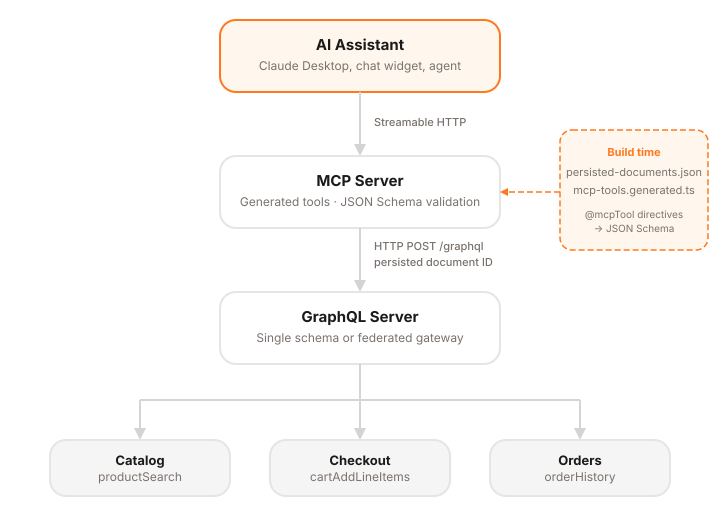

# graphql-mcp-tools

Generate [MCP](https://modelcontextprotocol.io/) tool definitions from your GraphQL operations. Annotate queries and mutations with `@mcpTool`, run codegen, get type-safe tools with JSON Schema inputs derived from your GraphQL schema.

This repo is the companion code for the blog post [Generating MCP tools from your GraphQL schema](https://labdigital.nl/blog/generating-mcp-tools-from-graphql). The article walks through the architecture, codegen pipeline, and safety model in detail. The code here is everything you need to try it yourself.



## How it works

1. Mark GraphQL operations with `@mcpTool` and `@mcpToolVariable` directives
2. Run [GraphQL Code Generator](https://the-guild.dev/graphql/codegen) — the included document transform filters to `@mcpTool` operations and generates persisted documents
3. A codegen plugin reads the persisted documents, converts GraphQL types to JSON Schema, and outputs typed tool definitions
4. At runtime, a thin wrapper turns each generated tool into an executable MCP tool handler

## Quick start

Clone the repo and install dependencies:

```bash
git clone https://github.com/labd/graphql-codegen-mcp-tools.git
cd graphql-mcp-tools
pnpm install
```

Run the example codegen to see it in action:

```bash
pnpm codegen
```

This generates `example/generated/mcp-tools.generated.ts` from the example schema and operations in `example/`.

To try the MCP server (uses mock data, no backend required):

```bash
pnpm example
```

### Using it in your own project

Copy or adapt the files from this repo into your project. The key pieces are:

| What                 | Where                               |
| -------------------- | ----------------------------------- |
| Directives           | `src/directives.graphql`            |
| Document transform   | `src/codegen/document-transform.ts` |
| Tools codegen plugin | `src/codegen/tools-plugin.ts`       |
| Directive stripping  | `src/codegen/strip-directives.ts`   |
| Runtime tool wrapper | `src/runtime/create-tools.ts`       |

You'll also need these dependencies:

```bash
pnpm add @modelcontextprotocol/sdk change-case graphql
pnpm add -D @graphql-codegen/cli @graphql-codegen/client-preset @graphql-codegen/plugin-helpers
```

### 1. Add the directives file

Copy `src/directives.graphql` into your project:

```graphql
directive @mcpTool(
  description: String!
  exclude: Boolean = false
) on QUERY | MUTATION

directive @mcpToolVariable(description: String) on VARIABLE_DEFINITION
```

### 2. Write your operations

```graphql
query GetProducts(
  $searchTerm: String @mcpToolVariable(description: "Free-text search query")
  $pageSize: Int! @mcpToolVariable(description: "Number of products per page")
  $page: Int! @mcpToolVariable(description: "Page number, starting at 1")
) @mcpTool(description: "Search products in the catalog") {
  productSearch(searchTerm: $searchTerm, pageSize: $pageSize, page: $page) {
    total
    results {
      name
      variant {
        sku
        price {
          gross {
            centAmount
            currency
          }
        }
      }
    }
  }
}
```

### 3. Configure codegen

See `example/codegen.ts` for a working config. The two key pieces are:

1. Use `mcpToolTransform` as a document transform to filter operations
2. Use `src/codegen/tools-plugin.ts` as a plugin to generate tool definitions from persisted documents

```typescript
// codegen.ts
import type { CodegenConfig } from "@graphql-codegen/cli";
import { mcpToolTransform } from "./src/codegen/index.js";

const config: CodegenConfig = {
  schema: [
    "./schema.graphql", // your schema
    "./src/directives.graphql", // MCP directives
  ],
  generates: {
    "./generated/": {
      documents: ["./operations.graphql"],
      preset: "client",
      documentTransforms: [mcpToolTransform],
      presetConfig: {
        persistedDocuments: {
          mode: "embedHashInDocument",
          hashPropertyName: "documentId",
        },
      },
    },
    "./generated/mcp-tools.generated.ts": {
      plugins: ["graphql-mcp-tools/codegen/tools"],
      config: {
        persistedDocumentsPath: "./generated/persisted-documents.json",
      },
    },
  },
};

export default config;
```

### 4. Run codegen

```bash
pnpm graphql-codegen --config codegen.ts
```

This generates `mcp-tools.generated.ts` with typed tool definitions and `persisted-documents.json` for use with your GraphQL server's operation registry.

### 5. Wire up an MCP server

See `example/server.ts` for a full working example with mock data. The key parts:

```typescript
import { createServer } from "node:http";
import { McpServer } from "@modelcontextprotocol/sdk/server/mcp.js";
import { StreamableHTTPServerTransport } from "@modelcontextprotocol/sdk/server/streamableHttp.js";
import { createToolFromGenerated } from "./src/runtime/index.js";
import type { GraphQLExecutor } from "./src/runtime/index.js";
import { generatedMcpTools } from "./generated/mcp-tools.generated.js";

// Replace with a real fetch to your GraphQL server
const executor: GraphQLExecutor = async (query, variables, documentId) => {
  const res = await fetch("http://localhost:4000/graphql", {
    method: "POST",
    headers: { "Content-Type": "application/json" },
    body: JSON.stringify({ query, variables }),
  });
  const { data, errors } = await res.json();
  if (errors?.length) throw new Error(JSON.stringify(errors));
  return data;
};

function createMcpServer(): McpServer {
  const server = new McpServer({ name: "my-graphql-mcp", version: "0.1.0" });
  const tools = generatedMcpTools.map((t) =>
    createToolFromGenerated(t, executor),
  );

  for (const tool of tools) {
    server.tool(
      tool.name,
      tool.description,
      tool.inputSchema,
      async (args) => ({
        content: [
          {
            type: "text",
            text: JSON.stringify(await tool.handler(args), null, 2),
          },
        ],
      }),
    );
  }
  return server;
}

// Stateless HTTP — each request gets a fresh server + transport
const httpServer = createServer(async (req, res) => {
  const server = createMcpServer();
  const transport = new StreamableHTTPServerTransport({
    sessionIdGenerator: undefined,
  });
  await server.connect(transport);
  await transport.handleRequest(req, res);
  res.on("close", () => {
    transport.close();
    server.close();
  });
});

httpServer.listen(3001);
```

## Connecting to Claude

The example server runs locally on HTTP (`http://localhost:3001`), but Claude Desktop needs a public HTTPS endpoint.

1. Start the MCP server:

```bash
pnpm example
```

2. In another terminal, expose it with ngrok:

```bash
ngrok http 3001
```

3. Copy the `https://...` forwarding URL from ngrok and use that in your Claude Desktop config.

4. In Claude Desktop, add that ngrok URL as a **Remote MCP server**.

   See: [Get started with custom connectors using remote MCP](https://support.claude.com/en/articles/11175166-get-started-with-custom-connectors-using-remote-mcp)

Or test locally with:

```bash
mcp-inspector --transport http http://localhost:3001
```

The port defaults to `3001` and can be changed via the `PORT` environment variable.

## Persisted documents

The codegen outputs `persisted-documents.json` mapping content hashes to query strings. You can register these with your GraphQL server's operation registry (GraphQL Hive, Apollo's persisted queries, or a custom solution) to reject any query not in the allowlist. This ensures the AI can only execute operations you've explicitly approved.

## API

### Codegen (`src/codegen/`)

- **`mcpToolTransform`** — Document transform that filters to `@mcpTool` operations and strips MCP directives from the output
- **`plugin`** (in `tools-plugin.ts`) — Codegen plugin that generates tool definitions from persisted documents
- **`stripMcpDirectives(query)`** — Strips `@mcpTool` / `@mcpToolVariable` from a query string

### Runtime (`src/runtime/`)

- **`createToolFromGenerated(tool, executor)`** — Wraps a generated tool with an executor function
- **`GeneratedMCPTool`** — Type for generated tool definitions
- **`ExecutableMCPTool`** — Type for tools with a handler
- **`GraphQLExecutor`** — Type for the executor function `(query, variables, documentId) => Promise<unknown>`

## License

MIT
